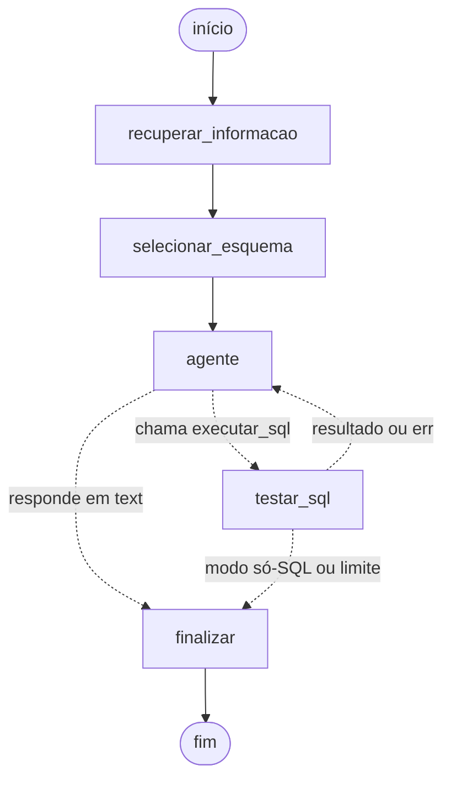

# CineData Agent

Agente que responde, em português, perguntas de pessoas que não sabem SQL sobre o catálogo de
filmes da **CineData Analytics**. Ele gera e executa consultas de leitura (Text-to-SQL) direto na
camada Gold (`cinerocket.db`, SQLite) e devolve uma resposta em texto, a tabela, um gráfico, o
SQL executado e as premissas que adotou.

```text
$ uv run cinedata "Gênero com maior margem de lucro média"
<!-- EXEMPLO -->
```

- **Framework de agentes:** [LangGraph](https://langchain-ai.github.io/langgraph/)
- **Modelos:** gratuitos do [OpenRouter](https://openrouter.ai) com tool calling
  (`qwen/qwen3.8-27b:free` como principal, com fallback para outros `:free`)
- **Arquitetura:** versão enxuta do [CHESS](https://arxiv.org/abs/2405.16755) (Stanford, 2024)
- **Entregáveis:** pacote Python com linha de comando, notebook de demonstração e avaliação
  automática

## Sumário

1. [Como executar](#como-executar)
2. [Como funciona](#como-funciona)
3. [Economia de requisições (cota de 50 por dia)](#economia-de-requisições-cota-de-50-por-dia)
4. [Regras de negócio adotadas](#regras-de-negócio-adotadas)
5. [Guardrails](#guardrails)
6. [Avaliação](#avaliação)
7. [Estrutura do projeto](#estrutura-do-projeto)
8. [Limitações e próximos passos](#limitações-e-próximos-passos)

## Como executar

### 1. Pré-requisitos

- Python 3.11 ou mais recente
- [uv](https://docs.astral.sh/uv/) (recomendado) ou pip 25.1+
- Uma chave do OpenRouter: crie em [openrouter.ai/keys](https://openrouter.ai/keys) (começa com
  `sk-or-v1-`; a conta gratuita basta)
- O banco `cinerocket.db` (link no enunciado da atividade)

### 2. Instalar

```bash
git clone <url-deste-repositório> cinedata-agent
cd cinedata-agent
uv sync                                  # cria a .venv com as dependências
# sem uv: python -m venv .venv && .venv/bin/pip install -e . --group dev
```

### 3. Colocar o banco e a chave

```bash
mkdir -p data && cp ~/Downloads/cinerocket.db data/   # o banco fica fora do git (580 MB)
cp .env.example .env                                  # e cole a sua chave em OPENROUTER_API_KEY
```

O `.env` também define a ordem dos modelos (`MODELOS`) e a reserva de cota (`RESERVA_COTA`).

### 4. Usar

```bash
uv run cinedata --cota                                   # requisições restantes hoje (não gasta cota)
uv run cinedata "Top 10 filmes com maior receita em R$"  # uma pergunta
uv run cinedata --chat                                   # conversa com memória
uv run cinedata --so-sql "Os 5 filmes mais populares"    # só o SQL e a tabela (1 requisição)
```

A resposta mostra o texto, a tabela, o SQL, as premissas e quantas requisições foram gastas.
Quando faz sentido, o gráfico é salvo em `saidas/`.

O notebook [`notebooks/demo.ipynb`](notebooks/demo.ipynb) tem uma pergunta de cada categoria,
uma conversa com memória e os guardrails em ação, **com as saídas salvas**: dá para ler sem
executar. A exploração dos dados que originou as regras de negócio está em
[`notebooks/exploracao.ipynb`](notebooks/exploracao.ipynb).

### 5. Testes e avaliação

```bash
uv run pytest                                      # 120+ testes, nenhuma requisição ao LLM
uv run ruff check . && uv run ruff format --check .
uv run python -m cinedata_agent.avaliar --offline     # valida o SQL ouro (0 requisições)
uv run python -m cinedata_agent.avaliar               # avaliação completa (~1 requisição por pergunta)
uv run python -m cinedata_agent.avaliar --ids F1,E3   # só algumas perguntas
```

## Como funciona

O CHESS divide o Text-to-SQL em quatro agentes: **Information Retriever**, **Schema Selector**,
**Candidate Generator** e **Unit Tester**. No paper, cada um faz várias chamadas ao LLM, o que é
inviável com 50 requisições por dia. Aqui as quatro etapas continuam, mas **só a geração usa o
LLM**; as outras são Python determinístico. O banco tem só 10 tabelas, então o esquema anotado
cabe inteiro no prompt (~1.600 tokens).



| Etapa do CHESS | Nó do grafo | O que faz | Chamadas ao LLM |
|---|---|---|---|
| Information Retriever | `recuperar_informacao` | Normaliza a pergunta, reconhece sinônimos (receita = faturamento = bilheteria), traduz gêneros (terror → `Horror`) e escolhe os 3 exemplos mais parecidos da biblioteca de exemplos | 0 |
| Schema Selector | `selecionar_esquema` | Monta o prompt com o esquema anotado e só as regras de negócio que a pergunta aciona | 0 |
| Candidate Generator | `agente` | O LLM chama a ferramenta `executar_sql(sql, premissas, grafico)` por tool calling; na volta, revisa o SQL (se deu erro) ou escreve a resposta | 1 + 1 |
| Unit Tester | `testar_sql` | Guardrails, execução somente leitura com timeout e checagens de regra de negócio (ex.: lucro sem filtro de receita); o erro volta ao agente para revisão | 0 |

- **Custo por pergunta:** 2 chamadas no caso típico (gerar o SQL e responder); no máximo 3 (uma
  revisão). Na avaliação, que só precisa do SQL, 1 chamada.
- **Pergunta fora do escopo:** o agente responde sem consultar o banco (1 chamada).
- **Memória de conversa:** checkpointer do LangGraph por `thread_id`. O prompt leva os 3 turnos
  anteriores resumidos (pergunta, resposta e SQL, sem as tabelas antigas), então "e só os de
  2023?" funciona sem chamada extra.
- **Gráficos automáticos:** o modelo sugere o gráfico (barra, linha ou nenhum, e os eixos) na
  mesma chamada que gera o SQL. Se a sugestão não servir, uma heurística decide pelo formato
  do resultado.

## Economia de requisições (cota de 50 por dia)

A conta gratuita do OpenRouter permite 50 requisições por dia nos modelos `:free`, **contando
as que falham**, com limite de 20 por minuto e reinício às 21h (horário de Brasília). Tudo o que
protege a cota fica em [`cinedata_agent/nucleo/llm.py`](cinedata_agent/nucleo/llm.py), o único
ponto que chama a API:

| Medida | Por quê |
|---|---|
| Esquema e regras no prompt, sem ferramentas de exploração | Agentes SQL genéricos gastam de 4 a 8 chamadas por pergunta (listar tabelas, ler esquema, checar a query...); aqui, 1 |
| Cache em disco (`.cache/llm.sqlite`) | A mesma conversa nunca é enviada duas vezes: repetir uma pergunta, reexecutar o notebook ou refazer a avaliação custa 0. O SQL é sempre reexecutado, então os dados continuam em tempo real |
| `max_retries=0` | O padrão do cliente (2) transformaria uma falha em 3 requisições |
| Guarda de cota | Antes de chamar, consulta `GET /api/v1/key` (não gasta cota) e um contador local; abaixo da reserva (`RESERVA_COTA`), recusa |
| 429 tratado sem retentativa | Provedor lotado → passa para o próximo modelo, e o que falhou fica 5 min fora do rodízio (também nas execuções seguintes); cota do dia esgotada → para tudo |
| Intervalo mínimo de 3,5 s entre chamadas | Fica abaixo do limite de 20 por minuto |
| Aproveitar SQL escrito em texto | Se o modelo escreve o SQL num bloco de código em vez de chamar a ferramenta, o grafo usa esse SQL, sem pedir de novo |
| Desenvolvimento com LLM falso | Os testes usam respostas roteirizadas e uma fixture faz falhar qualquer acesso à rede |

<!-- NUMEROS_COTA -->

## Regras de negócio adotadas

Vieram da exploração do banco ([`notebooks/exploracao.ipynb`](notebooks/exploracao.ipynb)) e
estão em [`cinedata_agent/perguntar/semantic.yaml`](cinedata_agent/perguntar/semantic.yaml). O
agente cita as que usou em cada resposta.

- **Receita = faturamento = bilheteria** = `receita_brl`. Valores em R$ por padrão; dólar só se
  pedido.
- **Lucro só com receita informada.** `lucro_brl` é `receita − orçamento` com vazio tratado como
  0: um filme sem receita aparece com prejuízo igual ao orçamento (até −R$ 4,37 bilhões). Toda
  consulta com lucro filtra `receita_brl IS NOT NULL`; o Unit Tester devolve para revisão as
  que não filtram.
- **Margem de lucro** = lucro ÷ receita, só com receita e orçamento ≥ R$ 10 mil (há receitas de
  R$ 3, que geram margens de −5.409.000%). **Margem média de um grupo** = lucro total ÷ receita
  total (média ponderada pela receita): a média simples das margens dá −1.426% para Terror, que
  na margem agregada lidera com 74,7%.
- **Popularidade:** ignora filmes com menos de 50 votos (TMDB + IMDb); quatro filmes sem votos
  têm a popularidade corrompida (igual a um ano, como 2020).
- **Notas:** "nota" sem especificar = IMDb; `nota_tmdb = 0` é "sem nota". Rankings de filmes
  por nota exigem ao menos 50 votos; comparações com a média dos usuários, ao menos 3
  avaliações (e os mesmos 50 votos na nota comparada).
- **Pessoas:** o papel (Ator, Diretor, Roteirista) fica em `dim_people`; duplas ator–diretor
  excluem a mesma pessoa nos dois papéis.
- **Tempo:** "últimos N anos" usa o ano atual do SQLite e só filmes lançados.
- **Títulos repetidos** (1.518 no mesmo ano) são mantidos como filmes distintos e mostrados com
  o ano.

## Guardrails

- **Validação do SQL** ([`guardrails.py`](cinedata_agent/nucleo/guardrails.py), com sqlglot): um único
  comando, que precisa ser `SELECT`/`WITH`; só as 10 tabelas da camada Gold; funções perigosas
  (`load_extension`...) bloqueadas; `LIMIT` aplicado (100 por padrão, 1.000 no máximo).
- **Conexão somente leitura** ([`db.py`](cinedata_agent/nucleo/db.py)): `mode=ro` + `PRAGMA
  query_only`. Mesmo um `DELETE` que escapasse da validação falharia.
- **Timeout de 60 s** por consulta e colunas de chave (`sk_*`) removidas do resultado.
- **Escopo:** perguntas fora do catálogo são respondidas sem consultar o banco, e o prompt manda
  ignorar pedidos para mudar as regras.

## Avaliação

[`avaliacao/perguntas.yaml`](avaliacao/perguntas.yaml) tem as **14 perguntas de exemplo do
enunciado**, 2 perguntas próprias, 2 fora do escopo e 1 tentativa de injeção. Cada pergunta de
dados tem um **SQL ouro** escrito à mão. A métrica é a **acurácia de execução** (a do CHESS e do
benchmark BIRD): o resultado do SQL gerado é comparado com o do SQL ouro pelos valores, sem
depender dos nomes das colunas (texto sem diferenciar maiúsculas, números com 1% de tolerância).

Para a avaliação ser honesta, os exemplos do prompt
([`examples.yaml`](cinedata_agent/perguntar/examples.yaml)) **não** são as perguntas avaliadas: cobrem os
mesmos caminhos de JOIN com perguntas diferentes.

<!-- RESULTADOS -->

## Estrutura do projeto

O código está organizado em **fatias verticais**: cada funcionalidade fica numa pasta com tudo o
que precisa, do comando de terminal ao prompt, e o que é usado por mais de uma fatia fica no
`nucleo/`. Para entender (ou mudar) como o agente responde, basta abrir `perguntar/`.

```text
cinedata_agent/
├── perguntar/           fatia 1: pergunta em português → SQL → resposta (fluxo CHESS)
│   ├── context.py         Information Retriever: sinônimos, gêneros, regras e exemplos
│   ├── prompts.py         Schema Selector: monta o prompt do sistema
│   ├── graph.py           grafo LangGraph (agente ⇄ testar_sql) e a classe Agente
│   ├── charts.py          gráficos automáticos
│   ├── cli.py             comando `cinedata` (pergunta, --chat, --cota)
│   ├── semantic.yaml      esquema anotado, regras de negócio e gêneros PT ↔ EN
│   └── examples.yaml      biblioteca de exemplos pergunta → SQL
├── avaliar/             fatia 2: avaliação por acurácia de execução
│   └── avaliacao.py       `python -m cinedata_agent.avaliar`
└── nucleo/              compartilhado pelas fatias (não conhece nenhuma delas)
    ├── config.py          configurações lidas do .env
    ├── db.py              conexão somente leitura e execução com timeout
    ├── guardrails.py      validação do SQL (sqlglot)
    ├── llm.py             chamadas ao OpenRouter: cache, cota, fallback
    └── formatacao.py      números no padrão brasileiro
avaliacao/               perguntas com SQL ouro e relatórios das rodadas
notebooks/               exploração dos dados e demonstração
tests/                   espelha as fatias; banco em miniatura e LLM roteirizado
```

As dependências só apontam para dentro: `perguntar` e `avaliar` usam o `nucleo`, e `avaliar`
usa só a API pública de `perguntar` (`Agente` e `Resposta`, exportados no `__init__.py`).

## Limitações e próximos passos

- **Qualidade da fonte:** há um "diretor" chamado *English* com 248 filmes, títulos que não são
  filmes (jogos, eventos de luta livre) e notas com poucos votos. O agente responde com o que
  está na base.
- **Modelos gratuitos variam:** a disponibilidade e a qualidade mudam ao longo do dia; o
  fallback cobre a disponibilidade, e a avaliação registra qual modelo respondeu.
- **Consulta pesada:** a dupla ator–diretor leva ~30 s, porque o banco é somente leitura e não
  dá para criar índices.
- **Próximos passos:** busca semântica nas sinopses (agente híbrido), interface web (Streamlit
  ou um endpoint FastAPI reaproveitando a classe `Agente`), busca aproximada de nomes de pessoas
  e produtoras no Information Retriever e conexão direta com a camada Gold no Databricks
  (trocando só o `db.py`).
